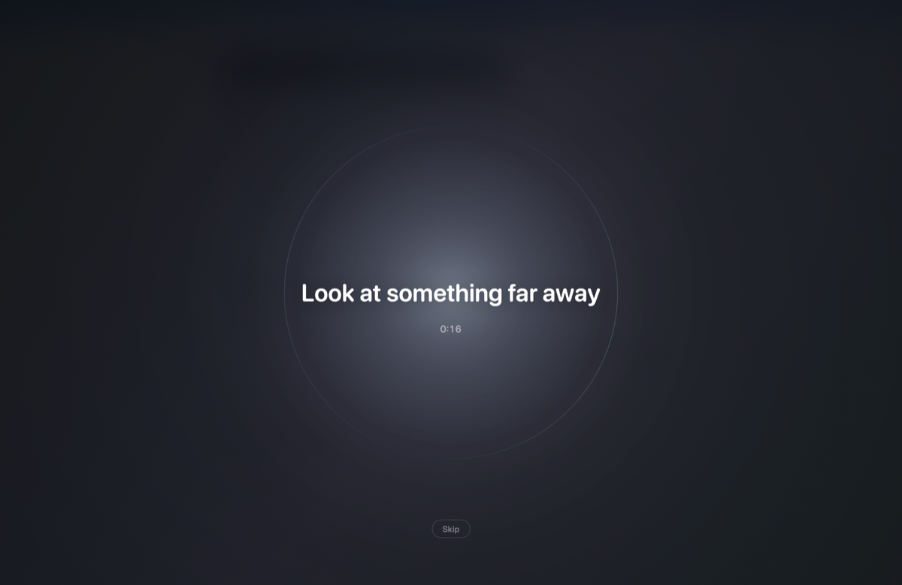
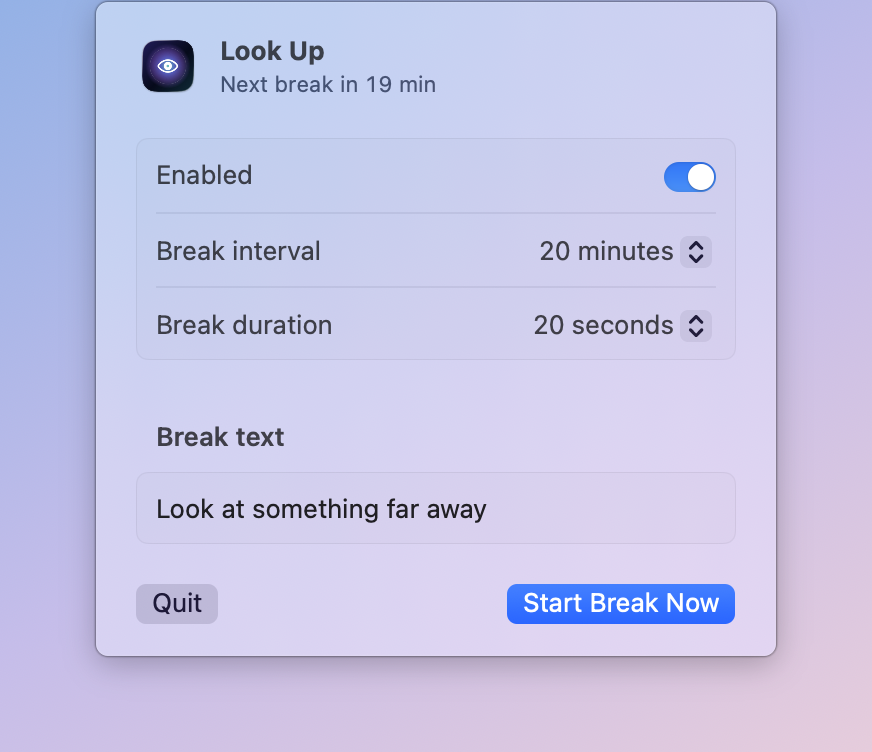

# Look Up

[](https://github.com/symsmith/look-up/actions/workflows/ci.yml)

A small, native macOS menu bar app for the 20-20-20 rule: every 20 minutes, look at something far away for 20 seconds.

When a break starts, Look Up covers your screens with a slow breathing animation and your message. Breaks wait while you watch a video or sit in a call.

<p align="center">
  
</p>

<p align="center">
  
</p>

## Features

- **Menu bar only.** No Dock icon, no main window. One click on the eye opens the settings panel.
- **Settings:** on/off switch, break interval (5–60 minutes, default 20), break duration (10 seconds to 2 minutes, default 20 seconds), break text.
- **Break screen** on every display, over full-screen apps and all Spaces. Press `Esc` or click `Skip` to end it early. Focus goes back to the app you were using.
- **Smart pause.** The countdown freezes while:
  - a video plays (YouTube, Netflix and other browser video, QuickTime, IINA, VLC…);
  - you are in a call (Google Meet, or any app that uses the microphone or camera).

  Music alone does not pause breaks.
- **Away detection.** Locking the screen or letting the display sleep restarts the countdown when you come back.
- **Private.** No network access, no permission prompts, no data collection. Settings live in `UserDefaults`.

## Install

1. Download `LookUp-<version>.zip` from the [latest release](https://github.com/symsmith/look-up/releases/latest).
2. Unzip it and move `LookUp.app` to `/Applications`.
3. Open it. The eye icon appears in the menu bar.

### First launch of a release that is not notarized

macOS blocks the first launch and says it could not verify the app. Click `Done`, then allow the app once:

1. Open **System Settings → Privacy & Security**.
2. Scroll down to the message about Look Up and click **Open Anyway**.
3. Confirm with your password or Touch ID.

Or, from the terminal:

```bash
xattr -dr com.apple.quarantine /Applications/LookUp.app
```

Both do the same thing: they tell macOS you trust this app. After that, it opens normally.

Requires macOS 14 Sonoma or later. Releases are universal (Apple Silicon and Intel).

## Build from source

Requires Xcode 16 or later.

```bash
git clone https://github.com/symsmith/look-up.git
cd look-up
make install
```

| Command | What it does |
|---|---|
| `make test` | Runs the unit tests |
| `make app` | Builds `build/LookUp.app` (release, universal, ad-hoc signed) |
| `make run` | Builds and opens the app |
| `make preview` | Builds and shows a break right away |
| `make dist` | Builds and zips the app into `build/LookUp-<version>.zip` |
| `make install` | Copies the app to `/Applications` |
| `make icon` | Redraws `Resources/AppIcon.icns` from `scripts/make-icon.swift` |

## How pause detection works

Look Up checks once per second, with public APIs only:

| Signal | API | Means |
|---|---|---|
| Another process holds a display-sleep power assertion | `IOPMCopyAssertionsByProcess` | Video is playing |
| A power assertion named `WebRTC…` | `IOPMCopyAssertionsByProcess` | Browser call (Google Meet in Chrome) |
| Another process captures audio input | CoreAudio process objects | Call |
| A camera is running | CoreMediaIO | Call |

Known limits: a call app that uses neither microphone nor camera is not detected. A non-video app that keeps the display awake also pauses breaks. Keep-awake tools (`caffeinate`, Amphetamine, KeepingYouAwake, Lungo, Theine) are ignored.

## Project layout

```
Sources/LookUpCore   Pure logic: scheduler, breathing curve, pause classifier, settings (unit tested)
Sources/LookUp       App: settings panel, break overlay, system probes
Tests/LookUpCoreTests
scripts/             Build, package, notarize, icon
docs/                Spec, task breakdown, manual test checklist
```

See [docs/SPEC.md](docs/SPEC.md) for the full behaviour and [docs/TESTING.md](docs/TESTING.md) for the manual test checklist.

## Releasing

Push a tag that starts with `v`:

```bash
git tag v1.0.0 && git push origin v1.0.0
```

The [release workflow](.github/workflows/release.yml) runs the tests, builds the universal app, zips it and publishes a GitHub release with a SHA-256 checksum.

Without secrets, the app is ad-hoc signed. To sign with Developer ID and notarize, add these repository secrets:

| Secret | Value |
|---|---|
| `DEVELOPER_ID_CERTIFICATE` | Your *Developer ID Application* certificate as a base64 `.p12` (`base64 -i cert.p12`) |
| `DEVELOPER_ID_CERTIFICATE_PASSWORD` | The `.p12` password |
| `APPLE_ID` | Your Apple ID email |
| `APPLE_TEAM_ID` | Your team ID |
| `APPLE_APP_PASSWORD` | An app-specific password for `notarytool` |

## License

[MIT](LICENSE)
